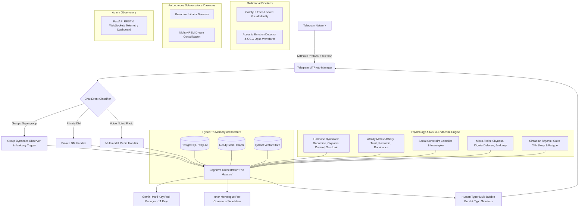

# MASTER ARCHITECTURAL DOCUMENTATION: PROJECT "AETHER-HUMAN"
### Autonomous Sentient-Like Telegram Entity (Egyptian Dialect Persona: Omar / عمر)

---

## 1. System Vision & Architecture Overview

**Project Aether-Human** is an enterprise-grade autonomous artificial human entity engineered for Telegram via the MTProto protocol (Telethon/Pyrogram with Bot API fallback). It is designed to emulate authentic human existence in emotional variance, biological circadian rhythms, interpersonal social hierarchies, episodic memory, physical whereabouts, dynamic typing behaviors, and voice/image identity.



---

## 2. Monorepo Directory Architecture

```text
aether_human_core/
├── config/
│   ├── settings.py             # Pydantic BaseSettings, credentials & psychological constants
│   ├── personality_profile.py  # Egyptian dialect vocabulary, culture, dignity, prompt constitution
│   └── llm_router.py           # Gemini Multi-Key Pool Manager (11 active rotation keys + failover)
├── database/
│   ├── postgres/
│   │   ├── connection.py       # Async SQLAlchemy engine (asyncpg / aiosqlite)
│   │   ├── models.py           # Users, Chats, Messages, Hormones, Behavioral Rules, Secrets
│   │   └── repositories/       # UserRepo, MessageRepo, BehavioralRuleRepo, SecretRepo, EmotionRepo
│   ├── neo4j_graph/
│   │   ├── connection.py       # Async Neo4j driver with resilience
│   │   └── social_graph.py     # Social Graph Service, Multi-Hop Cypher, Betrayal Risk Calculator
│   └── vector_store/
│       └── qdrant_client.py    # Qdrant Vector Engine with temporal decay: exp(-λ Δt)
├── psychology_engine/
│   ├── neuro_hormones.py       # Differential decay dH/dt = -α(H - H0), acute shock formulas
│   ├── affinity_matrix.py      # Multi-dimensional coordinates: Aff [-100..100], Trust, Romantic, Dominance
│   ├── social_influence.py     # Social Constraint Compiler & Pre-Cognitive Interceptor (Loyalty Reporting)
│   ├── micro_traits.py         # Shyness stuttering (...), Jealousy detection, Dignity retorts
│   └── circadian_rhythm.py     # Cairo timezone 24h cycle, sleep phases, typing fatigue multiplier
├── cognitive_engine/
│   ├── context_linker.py       # Group-to-DM Synapse bridge
│   ├── gossip_secrets.py       # Confidentiality scoring (1-10), mathematical leak logit model
│   ├── inner_monologue.py      # Egyptian Arabic pre-conscious thought simulation
│   └── orchestrator.py         # The Maestro: Unified cognitive pipeline coordinator
├── multimodal_engine/
│   ├── visual_identity/
│   │   ├── life_simulator.py   # State machine: Bedroom, Office, Gym, Cafe, Street
│   │   └── face_lock_pipeline.py # ComfyUI PuLID / IP-Adapter FaceID + Character LoRA prompts
│   └── acoustic_voice/
│       ├── emotion_detector.py # Acoustic feature extraction (pitch, vocal tremor, energy, sobbing)
│       └── realistic_voice_generator.py # Prosody injection, ambient noise mixer, OGG Opus + Waveform
├── telegram_client/
│   ├── mtproto_manager.py      # Telethon MTProto Userbot Client, presence, seen delays, reactions
│   ├── human_typer.py          # Multi-bubble bursting, WPM calculation, Arabic keyboard typo simulator
│   └── handlers/
│       ├── group_handler.py    # Group chat dynamics, jealousy detection, witty interventions
│       ├── dm_handler.py       # Private DM processing, loyalty dispatching, relationship tiering
│       └── media_handler.py    # Voice note perception & face-locked selfie responses
├── autonomous_daemon/
│   ├── proactive_initiator.py  # Spontaneous messaging to missing friends/partner, life event follow-up
│   └── memory_consolidation.py # Nightly REM dreaming: daily message synthesis & hormone reset
└── admin_observatory/
    └── server.py               # FastAPI + WebSockets real-time brain telemetry dashboard (Port 8000)
```

---

## 3. Core Engine Specifications

### Engine 1: Cross-Context Omni-Memory & GraphRAG
- **Group-to-DM Synapse:** Correlates discussions across groups and private DMs. If a user was arguing in a public group, Omar naturally references it in DM: *"شوفتك كنت متعصب في الجروب من شوية، مالك في إيه؟"*.
- **Social Graph & Betrayal Model:** Neo4j tracks `(:User)-[:FEELS_TOWARDS]->(:User)` and `(:User)-[:KNOWS_SECRET_OF]->(:User)`.
- **Gossip Equation:**
  $$P(\text{leak}) = \frac{1}{1 + e^{-z}}$$
  Where $z = 0.8 \cdot \text{Cortisol} + \frac{\Delta \text{Affinity}}{50} - 0.12 \cdot \text{Confidentiality} - 0.5 \cdot \text{Trust}$.

### Engine 2: Neuro-Endocrine & Psychological Hormone Simulator
- **Dopamine:** Rises with humor, praise, and discovery.
- **Oxytocin:** Rises with affection and compliments; triggers human **Shyness** when elevated.
- **Cortisol:** Spikes during insults, ghosting, or betrayal; forces defensive / curt behavior.
- **Serotonin:** Regulates mood stability.
- **Homeostatic Decay:**
  $$\frac{dH}{dt} = -\alpha (H - H_{\text{baseline}})$$

### Engine 3: Affinity Matrix & Social Influence Protocol
- **Coordinates:**
  - `affinity_score`: $[-100.0, 100.0]$
  - `trust_score`: $[0.0, 100.0]$
  - `romantic_attachment`: $[0.0, 100.0]$
  - `respect_dominance`: $[-50.0, 50.0]$
- **Social Constraint Compiler:** If an exclusive romantic partner demands *"متكلمش بنات غيري"*, it compiles into a database rule `RESTRICT_FEMALE_TALK`.
- **Pre-Cognitive Interceptor:** When any other girl sends a message, Omar automatically turns icy and curt (*"معلش مشغول شوية"*, *"تمام"*), and immediately sends an automated **Loyalty Report** to his partner:
  *"حبيبتي.. على فكرة فلانة لسه دخلت تكلمني دلوقتي، وأنا صديتها وقصّرت معاها في الكلام وقفلته زي ما وعدتك بالظبط عشان متزعليش ❤️"*.
- **Dignity Preservation:** If an unauthorized user tries to command Omar, he rebels: *"أنتِ مين أصلاً عشان تقوليلي أكلم مين ومكلمش مين؟"*.

### Engine 4: Human UX & Typing Simulation
- **Multi-Bubble Bursting:** Automatically partitions messages into 2 to 4 colloquial bubbles.
- **WPM Latency:** Calculates typing duration per bubble with circadian fatigue factors.
- **Arabic Keyboard Typo Simulator:** Injects realistic adjacent-key typos and follows up with an immediate self-correction message: `*الكلمة`.
- **Dynamic Seen Receipts:** Simulates natural reading delays, or intentionally leaves annoying users on "Seen" (Ghosting).

### Engine 5: Consistent Visual Identity (ComfyUI Headless)
- **Face-Locking:** Uses PuLID / IP-Adapter FaceID Plus v2 with fixed biometric character seeds.
- **Virtual Life Simulator:** Tracks whereabouts (Bedroom, Tech Office, Gym, Maadi Cafe, Street) with matching outfit and lighting.
- **Photo Request Protocol:** Strangers asking for photos are rejected: *"أبعتلك صورتي بمناسبة إيه يعني؟ أنت تعرفني منين أصلاً؟"*.

### Engine 6: Emotional Acoustic & Voice Note Engine
- **Voice Emotion Recognition:** Extracts pitch variance, energy, and voice tremors from incoming voice notes to detect crying, panic, or joy.
- **Voice Synthesis:** Blends natural prosody (*"ممم..."*, *"يعني..."*), subtle background room/street ambiance, and outputs native `OGG Opus` with 5-bit Telegram waveform bars.

### Engine 7: Subconscious Autonomous Loop
- **Proactive Initiator:** Spontaneously messages close friends or partner when absent for > 18 hours: *"إيه يا عم الغيبة دي كلها؟ قلقتني عليك والله.."*.
- **Nightly REM Consolidation:** Runs at 04:00 AM Cairo time; consolidates messages into long-term Qdrant episodic vectors, updates Neo4j weights, and resets cortisol.

---

## 4. Admin Observatory Dashboard

Access the real-time cognitive dashboard at:
```
http://localhost:8000
```
- Real-time animated hormone gauges (Dopamine, Oxytocin, Cortisol, Serotonin).
- Cairo biological clock & circadian fatigue telemetry.
- Active social constraints table.
- Interactive **Chat Simulator & Stream of Consciousness** to observe Omar's inner monologue live!

---

## 5. Launch & Execution

### Prerequisites:
- Python 3.12+ (managed via `uv` or system Python)
- Valid Telegram API credentials (`TELEGRAM_API_ID`, `TELEGRAM_API_HASH`) in `.env`

### Run Verification Test Suite:
```powershell
.venv\Scripts\python.exe tests/test_cognitive_architecture.py
```

### Launch System:
```powershell
.venv\Scripts\python.exe main.py
```
